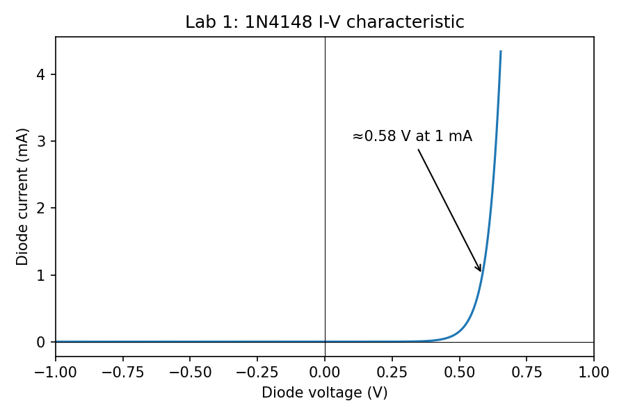
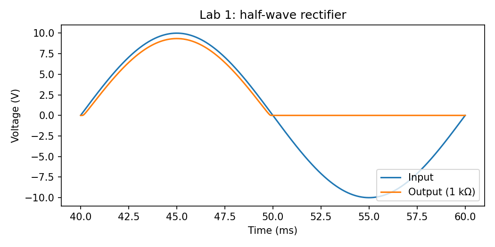
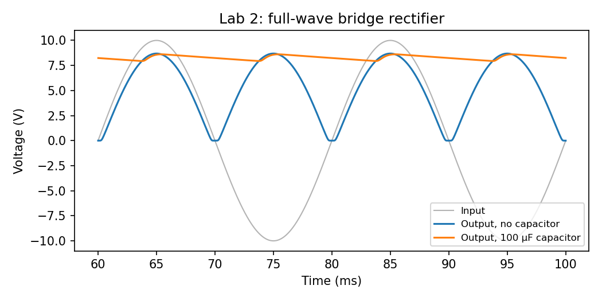
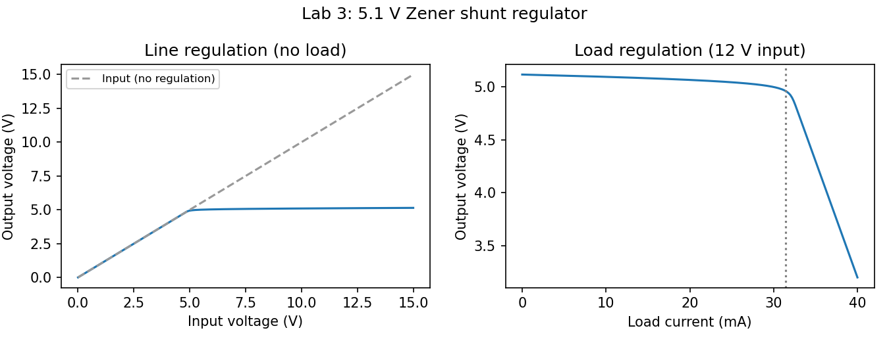

# CSE251 Electronic Devices and Circuits: diode labs

SPICE simulations of the three diode labs from **CSE251 Electronic Devices and Circuits** at BRAC University: diode characteristics and half-wave rectification, the full-wave bridge rectifier, and the Zener voltage regulator. Each circuit is simulated in **ngspice**, and a Python script extracts the key measurements, checks them against hand calculations, and plots the waveforms.

> **About this repository:** I took CSE251 at BRAC University but lost my original LTspice lab files. These circuits were rebuilt from scratch in 2026 around the same lab topics, with automated measurements and tests added. They aren't the original submissions.

## Results

| Lab | Measurement | Simulated | Hand calculation |
|---|---|---|---|
| 1 | 1N4148 forward voltage at 1 mA | 0.585 V | ≈ 0.6 V (silicon) |
| 1 | Half-wave output peak (10 V input) | 9.34 V | 10 − 0.7 ≈ 9.3 V |
| 1 | Half-wave DC (average) output | 2.87 V | V<sub>p</sub>/π ≈ 2.97 V |
| 2 | Bridge loss (two diodes conduct) | 1.31 V | 2 × 0.65 ≈ 1.3 V |
| 2 | Ripple frequency | 100 Hz | 2 × 50 Hz |
| 2 | DC output, without and with 100 µF | 5.17 V → 8.29 V | 2V<sub>p</sub>/π ≈ 5.5 V → close to V<sub>p</sub> |
| 2 | Ripple with 100 µF | 0.67 V<sub>pp</sub> | V<sub>p</sub>/(2fRC) ≈ 0.86 V (upper estimate) |
| 3 | Regulated output at 12 V input | 5.12 V | 5.1 V Zener |
| 3 | Line regulation (8–15 V input) | 9.6 mV/V | — |
| 3 | Load regulation (0 → 20 mA) | 1.0 % | — |
| 3 | Load current where regulation fails | 32.6 mA | (12 − 5.1)/220 Ω ≈ 31.4 mA |






## Circuits

| File | Circuit |
|---|---|
| `circuits/lab1_diode_iv.cir` | 1N4148 with a 1 kΩ series resistor, DC sweep from −5 to 5 V |
| `circuits/lab1_half_wave.cir` | 10 V peak, 50 Hz source, 1N4007, 1 kΩ load |
| `circuits/lab2_full_wave_bridge.cir` | Four 1N4007s in a bridge with a 1 kΩ load, run without and with a 100 µF capacitor |
| `circuits/lab3_zener_regulator.cir` | 5.1 V Zener with a 220 Ω series resistor: input sweep (line regulation) and load sweep (load regulation) |
| `circuits/models.lib` | Diode models (1N4148, 1N4007, 5.1 V Zener) |

The netlists are plain SPICE, so they also open in LTspice.

## Run

```bash
brew install ngspice          # or: sudo apt install ngspice
pip install -r requirements.txt
python analyze.py             # simulate, print measurements, save plots to results/
python -m unittest -v         # 12 checks against hand calculations
```

GitHub Actions reruns every simulation and test on each push.
